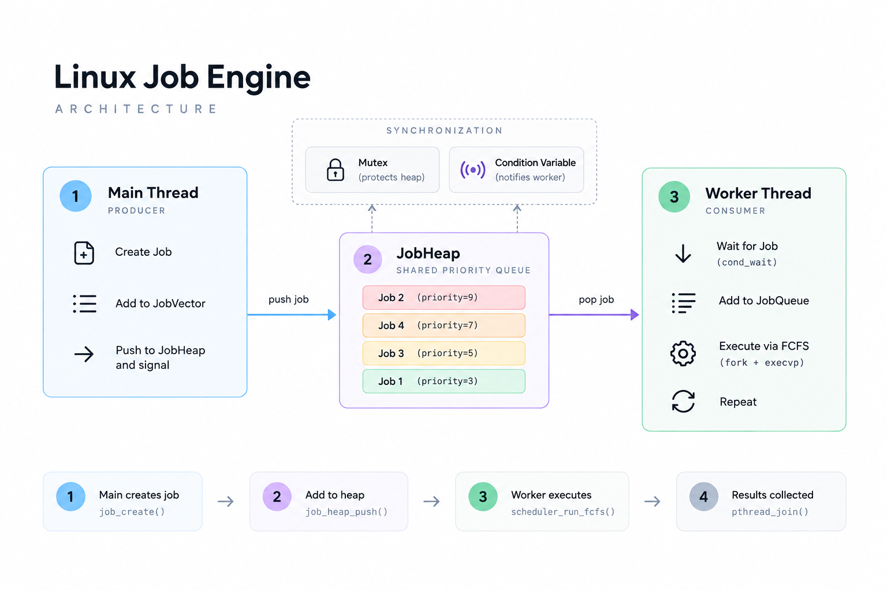

#LINUX Job Engine

A Linux job scheduling engine written in C.

A project focused on Operating Systems,
Data Structures, Algorithms, and Software Engineering.

## Features

 - Job creation and state managment
 - Dynamic Array and Linked List
 - FIFO Queue
 - Binary Max Heap
 - Linux process managment (fork, execvp, waitpid)
 - FCFS Scheduling

## Architecture


## Technologies

 - C11
 - Linux
 - GCC
 - Make

## Build and Run

```bash
make
make run
```

## Project Structure

```text
linux-job-engine/
-- include/         # Header files  
-- src/		    # Source code
-- tests/	    # Tests
-- Makefile
-- README.md
```

## Roadmap

 - [x] Dynamic Array, FIFO Queue, Binary Heap
 - [x] Linux Process Management
 - [x] FCFS Scheduling
 - [x] Priority Scheduling
 - [ ] SJF and Round Robin
 - [x] Multithreading and Synchronization
 - [ ] IPC and Networking

## Purpose

Learn how Linux proceses, scheduling algorithms, data structures work together in a real C project.
